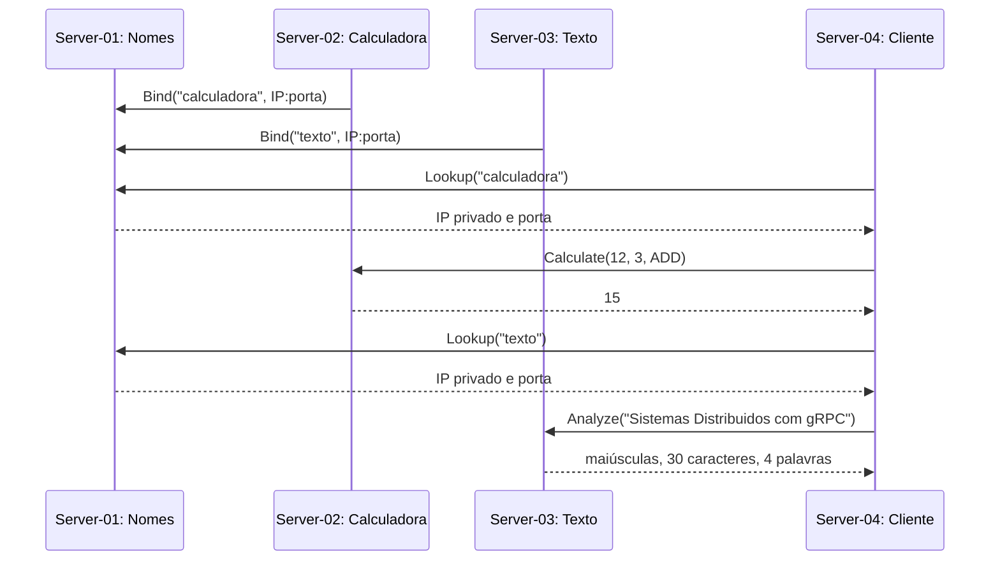

# ASR11 — Serviços remotos e Serviço de Nomes em gRPC

Implementação em Python para Sistemas Distribuídos. Há quatro programas/processos: Serviço de Nomes, calculadora, análise de texto e cliente. Na AWS, cada um executa em uma máquina diferente.

## Arquitetura



O cliente recebe somente o endereço do Serviço de Nomes. Os endereços da calculadora e do serviço de texto são obtidos por `Lookup` antes de cada chamada. Eles não ficam fixados no código do cliente. Requisições e respostas usam os stubs gerados do contrato [contracts.proto](protos/sdgrpc/contracts.proto).

## Serviços definidos

| Serviço | RPCs | Comportamento |
| --- | --- | --- |
| NamingService | Bind, Lookup, Unbind, Rebind | Associa nomes lógicos a endereços |
| CalculatorService | Calculate | Soma, subtração, multiplicação e divisão de dois números |
| TextService | Analyze | Converte para maiúsculas e conta caracteres Unicode e palavras |

### Semântica do Serviço de Nomes

- **bind** registra um nome ainda inexistente. Nome duplicado retorna `ALREADY_EXISTS` e preserva o registro anterior.
- **lookup** devolve host/porta. Nome inexistente retorna `NOT_FOUND`.
- **unbind** remove um registro. Nome inexistente retorna `NOT_FOUND`.
- **rebind** substitui o endereço de um nome; se o nome não existe, cria o registro. Essa escolha segue a semântica usual de rebind e está coberta por teste.

Os servidores de aplicação chamam `Bind` ao iniciar. Em uma reinicialização, um registro já existente é atualizado por `Rebind`. SQLite mantém os registros após reiniciar o Serviço de Nomes. Uma trava serializa as transações concorrentes. A chave primária impede nomes duplicados.

Cada RPC tem um prazo de espera no cliente. Divisão por zero, operandos não finitos, nomes e endereços inválidos retornam erros gRPC. Resultados numéricos não representáveis retornam `OUT_OF_RANGE`.

## Organização

```text
protos/sdgrpc/contracts.proto  contrato dos três serviços
sdgrpc/contracts_pb2*.py       mensagens e stubs gerados pelo protoc
sdgrpc/naming.py               registro SQLite e operações de nomes
sdgrpc/applications.py         calculadora e análise de texto
sdgrpc/server.py               inicialização de cada servidor
sdgrpc/client.py               descoberta e acesso aos serviços; CLI administrativa
tests/test_grpc.py             11 testes de integração gRPC
tools/demo_local.py            demonstração com quatro processos
tools/verify_live.py           teste entre as máquinas EC2
deployment/                   inventário e instalação reproduzível
```

## Executar localmente

Requer Python 3.10 ou superior. Dependências estão fixadas em `requirements.txt`; foram testadas com Python 3.13 no Windows e a instalação EC2 usa Python 3.14.

No Windows, dentro desta pasta:

```powershell
python -m venv .venv
.venv\Scripts\python -m pip install -r requirements.txt
.venv\Scripts\python tools/generate.py
.venv\Scripts\python -m unittest discover -s tests -v
.venv\Scripts\python tools/demo_local.py
```

No Linux, substitua `.venv\Scripts\python` por `.venv/bin/python`. A demonstração inicia os servidores em portas locais livres, executa o cliente, verifica os resultados e encerra os três servidores.

Para executar manualmente, use quatro terminais, todos nesta pasta:

```bash
# Terminal 1: Serviço de Nomes
python -m sdgrpc.server names --port 50061 --database var/names.sqlite3

# Terminal 2: calculadora
python -m sdgrpc.server calculator --port 50062 --naming 127.0.0.1:50061

# Terminal 3: texto
python -m sdgrpc.server text --port 50063 --naming 127.0.0.1:50061

# Terminal 4: cliente
python -m sdgrpc.client --naming 127.0.0.1:50061 demo
python -m sdgrpc.client --naming 127.0.0.1:50061 calc 12 3 --operation divide
python -m sdgrpc.client --naming 127.0.0.1:50061 text "Olá, Sistemas Distribuídos!"
```

### Testar as quatro operações de nomes pela CLI

Com o Serviço de Nomes ligado:

```bash
python -m sdgrpc.client bind exemplo 127.0.0.1 50062
python -m sdgrpc.client lookup exemplo
python -m sdgrpc.client rebind exemplo 127.0.0.1 50063
python -m sdgrpc.client lookup exemplo
python -m sdgrpc.client unbind exemplo
python -m sdgrpc.client lookup exemplo
```

O último comando retorna `NOT_FOUND`, com código de saída 2, porque o registro foi removido.

## Distribuição na AWS Academy

| Máquina | Papel | Endereço privado |
| --- | --- | --- |
| Server-01 | Serviço de Nomes | 172.31.65.237:50061 |
| Server-02 | Calculadora | 172.31.68.163:50062 |
| Server-03 | Texto | 172.31.64.70:50063 |
| Server-04 | Cliente | 172.31.75.104 |

O projeto é instalado em `/home/ubuntu/sd-grpc`. Os servidores executam como `ubuntu` em unidades systemd chamadas `sd-grpc-names`, `sd-grpc-calculator` e `sd-grpc-text`. Elas iniciam com a máquina e reiniciam se o processo falhar. O cliente é um comando sob demanda.

Na **Server-04**:

```bash
cd ~/sd-grpc
./run-client.sh demo
./run-client.sh calc 20 4 --operation divide
./run-client.sh text "Acesso remoto por gRPC"
.venv/bin/python tools/verify_live.py --naming 172.31.65.237:50061
```

Em cada máquina de servidor, para conferir o processo e os logs:

```bash
systemctl status sd-grpc-names        # Server-01
journalctl -u sd-grpc-names -n 30 --no-pager
systemctl status sd-grpc-calculator   # Server-02
systemctl status sd-grpc-text         # Server-03
```

Para parar os programas deste exercício, execute `sudo systemctl disable --now sd-grpc-<papel>` na máquina correspondente. Isso não encerra a EC2. Os custos do laboratório continuam associados às máquinas e demais recursos em uso.

### Reproduzir a instalação

O script usa AWS CLI e OpenSSH, sem copiar chaves privadas para a aplicação nem para as EC2:

```powershell
.venv\Scripts\python deployment/deploy.py --key "$HOME\.ssh\sd-grpc-lab.pem"
```

O inventário precisa estar atualizado se os IPs mudarem. O script confere o acesso às quatro máquinas, cria somente a regra TCP 50061–50063 com origem no próprio security group compartilhado e mantém as regras existentes. O pacote enviado inclui apenas arquivos da aplicação, sem `.venv`, chaves ou credenciais AWS.

## Limites desta implementação didática

- O gRPC usa transporte sem TLS, restrito às interfaces privadas e ao grupo das quatro máquinas. Não exponha essas portas à Internet; produção exige TLS e controle de acesso.
- O Serviço de Nomes é centralizado: sua indisponibilidade impede novas descobertas. Não há replicação, leases ou remoção automática de registros quando uma máquina falha. `Unbind` é explícito; reiniciar um aplicativo atualiza o próprio registro por `Rebind`.
- Não há autenticação de quem altera nomes. Os membros do grupo privado são considerados confiáveis neste exercício.
- “Caracteres” significa pontos de código Unicode (`len` do Python), e palavras são sequências separadas por espaço em branco (`split`).
- O armazenamento persistente fica no disco da Server-01; não foi criada infraestrutura adicional.

## Referências

- [Quickstart oficial gRPC/Python](https://grpc.io/docs/languages/python/quickstart/): definição `.proto`, geração de mensagens/stubs e chamadas cliente-servidor.
- [Serviço de nomes simples indicado no enunciado](https://github.com/professorfabio/gRPC-SimpleNamingService): referência conceitual para Bind, Lookup, Unbind e Rebind. O código desta entrega foi implementado separadamente, com contrato próprio, persistência, validação e testes.
